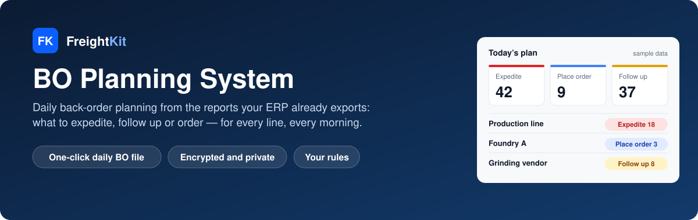
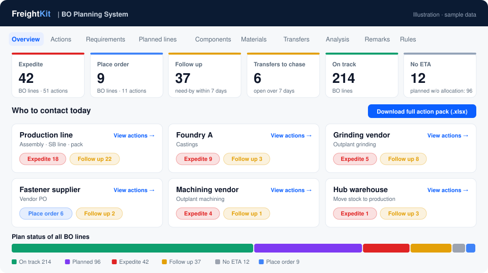
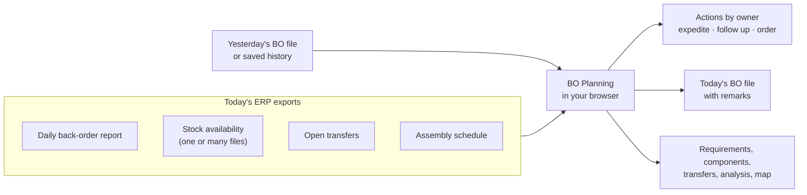
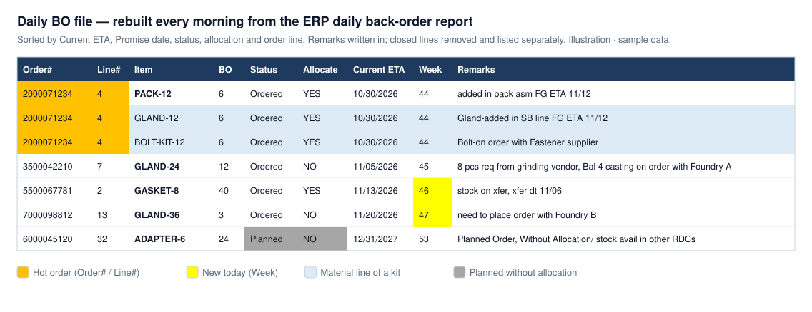
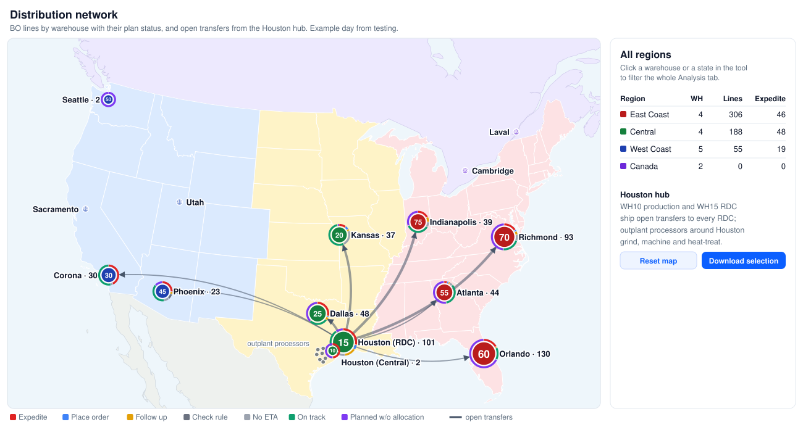

<div align="center">

<a href="https://freightkit.in/bo-planning/"></a>

# FreightKit

**Daily back-order planning for manufacturers and distributors.**<br>
Every morning, from the reports your ERP already exports: what to expedite, follow up or order, line by line.

[](#bo-planning-system) [](#rights) [](#rights) [](https://freightkit.in/)

[**The product**](#bo-planning-system) · [How a day works](#how-a-day-works) · [Daily BO file](#daily-bo-file) · [Security](#security) · [Results](#results) · [Contact](https://freightkit.in/contact/)

</div>

---

<a id="bo-planning-system"></a>
## 1. BO Planning System

A private planning system for teams that manage open back orders every day. It reads your daily exports, matches stock, transfers and production to every order line in ETA order, and tells each owner — production, foundries, outside processors, suppliers, receiving — exactly what to do today. It also writes the line remarks and gives back the day's BO file, ready to share.

| Every morning, without it | With BO Planning |
| --- | --- |
| Hours rebuilding the BO file and checking stock, transfers and schedules line by line | The BO file and the full plan in seconds, from the same exports |
| Remarks typed by hand and often out of date | Remarks checked against today's data; true ones kept, the rest suggested |
| Shortages and late lines found too late | Every shortage becomes "place order"; late lines flagged against the customer ETA |
| Hard to see the whole network | Dashboard, filters and an interactive warehouse map |
| Know-how in a few people's heads | Routes, suppliers, lead times and wording kept as rules anyone can edit |

<p align="center"><br><sub>Overview: what to do today, by owner, with one-click Excel. <i>Illustration with sample data.</i></sub></p>

---

<a id="how-a-day-works"></a>
## 2. How a day works



1. **Drop in today's files.** Any combination works; each screen says which file it still needs.
2. **Yesterday carries over.** Remarks, actions, special instructions, hot orders and manual item details continue from yesterday's file or the history kept on your computer.
3. **Supply goes to the earliest ETA first.** Each line walks its route — stock at the warehouse, open transfers, production and assembly, outside processes, open orders — and anything still missing becomes **place order**.
4. **Kits and packs are checked part by part** from the bill of materials.
5. **Timing is checked against the customer ETA**, including production and transfer time, so late lines show up today, not next week.

---

<a id="daily-bo-file"></a>
## 3. The daily BO file, built for you

<p align="center"><br><sub>The BO file your team already uses, rebuilt every morning. <i>Illustration with sample data.</i></sub></p>

- **New lines added, closed lines removed** — and both listed separately with their remarks.
- **Sorted the way planners work:** customer ETA, promise date, order status, allocation, order date, order line.
- **Highlights kept:** hot orders, today's new lines, kit material lines, planned lines without allocation.
- **Item master and bill of materials built in**, with add, change and delete as items change.
- **Download** the updated workbook in your own layout, or only the lines that changed.

---

<a id="inside-the-tool"></a>
## 4. Everything on one screen

| Screen | What you get |
| --- | --- |
| **Overview** | Counts to expedite, order and follow up; a card per owner; new and closed lines; reserve stock that can save late lines |
| **Actions** | Every action with need-by date, owner and the stock behind it; filters by status, owner, warehouse, customer and dates |
| **Requirements & Materials** | What each item still needs, beside stock, open orders and forecast |
| **Components** | Stock at every process stage, coverage in months and what to push through each process |
| **Transfers** | Open transfers, their age and the order lines they serve |
| **Analysis** | Charts by status, owner, region, warehouse, week and customer, plus the network map |
| **Remarks** | Each remark checked against today; edit, mark hot orders, download the updated BO file |
| **Rules** | Routes, suppliers, lead times, warehouses, wording, item master and BOM — edit, export, import |

<p align="center"><br><sub>Analysis → distribution network. Click a warehouse or region to filter everything; download the selection. <i>Illustration with sample warehouses and data.</i></sub></p>

**Built around real operations:** emergency reserve stock is never used by the plan but offered when a line is late; castings already on order are followed up, not re-ordered; weights count once per order line; kit lines can be completed by hand when the item master cannot describe them.

---

<a id="security"></a>
## 5. Security and privacy

| Protection | How it works |
| --- | --- |
| **Your files stay with you** | Every file is opened and calculated inside the browser. Nothing is uploaded; the page is blocked from sending data to any other site. |
| **Encrypted product** | The planning system ships encrypted (AES-256-GCM, key derived from the sign-in with PBKDF2-SHA256, 600,000 rounds). Without the sign-in it cannot be read or run. |
| **Protected history** | The day-to-day remarks history is kept on the user's computer, encrypted with a key from the sign-in. One click removes everything. |
| **Automatic sign-out** | After one hour without activity the session ends and everything loaded is cleared. |
| **Private source** | Source code, rules and customer files are never published; this repository is private. |

**Coming next:** user accounts with saved work, so each planner keeps their workspace on any computer.

---

<a id="results"></a>
## 6. Proven on real data

Built and checked against a real team's daily files: about 750–800 back-order lines a day.

| Check | Result |
| --- | --- |
| Agreement with the planners' own remarks | **about 4 in 5 lines** (up to 82 %); the rest mostly remarks behind today's stock |
| BO file rebuilt from the ERP daily report | **identical plan** to the team's own file on all 788 lines |
| New lines, hot orders and planned lines found | **match the team's highlights** |
| Stock used twice, or more than the file holds | **0** |
| A later-ETA line served before an earlier one | **0** |
| Transfers used beyond their open quantity | **0** |

These checks are run again whenever the rules change.

---

## 7. Also from FreightKit

| Offer | What it is |
| --- | --- |
| 🛠️ **Custom planning systems** | We build private tools like this one around your own exports and rules. [Services](https://freightkit.in/services/) · [Contact](https://freightkit.in/contact/) |
| 🧮 **Free tools** | 40+ calculators for freight, inventory and procurement, a freight invoice review and a custom calculator builder — no sign-up. [All tools](https://freightkit.in/tools/) |
| 📥 **Templates and guides** | 27 CSV templates, 5 Excel workbooks and practical guides. [Templates](https://freightkit.in/templates/) · [Guides](https://freightkit.in/guides/) |

Every page and download is listed in the **[links folder](links/)** (also as [links.csv](links/links.csv)).

---

<details>
<summary><b>For maintainers</b></summary>

```text
FreightKit/
├── bo-planning/   BO Planning System: sign-in page and encrypted app.bundle
├── tools/         Free calculators and file tools
├── templates/ downloads/ guides/ services/ …   Other website pages and files
├── assets/        Styles, scripts, images, vendor libraries
├── links/         All pages and links (scripts/build-links-page.py)
├── docs/          Hosting notes and README images
└── scripts/       Site checks, search index, links page, BO bundle and master builders
```

```bash
python scripts/check-site.py          # links, assets and SEO tags
python scripts/build-links-page.py    # refresh links/
python scripts/build-bo-bundle.py     # rebuild the encrypted BO Planning bundle
```

- The BO Planning source, rules, master data and customer files are never committed; only `bo-planning/app.bundle` is.
- Never commit passwords, keys, `contact-config.php` or customer files.
- Website: **freightkit.in** (Hostinger, `public_html`).

</details>

---

<a id="rights"></a>
<div align="center">

**Want a planning system built around your own reports?** [Contact FreightKit](https://freightkit.in/contact/)

<sub>© 2026 FreightKit. All rights reserved. Proprietary software in a private repository: no licence is granted to use, copy, modify or distribute any part of this code, design or content.</sub><br>
<sub>Results are decision support; confirm supplier, carrier, customs and tax details before acting.</sub>

</div>
