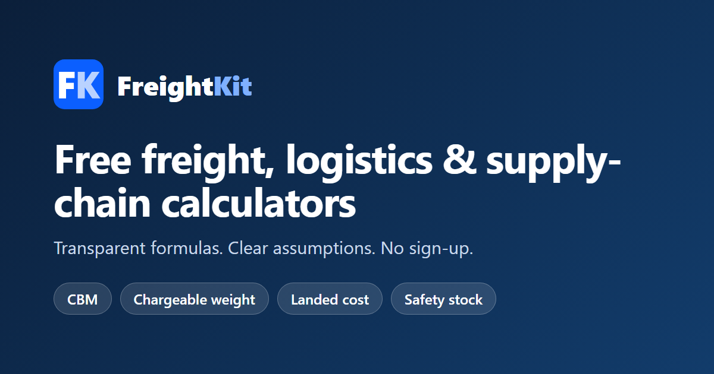
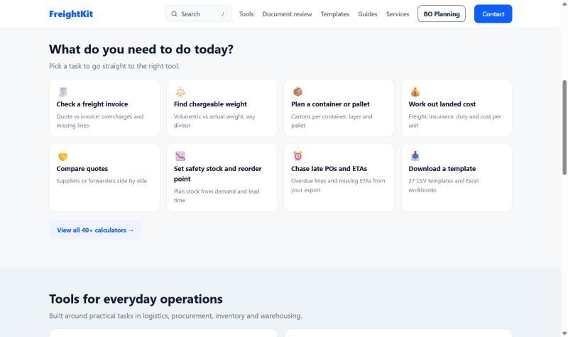
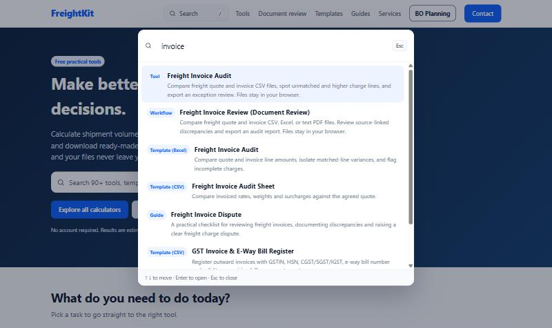
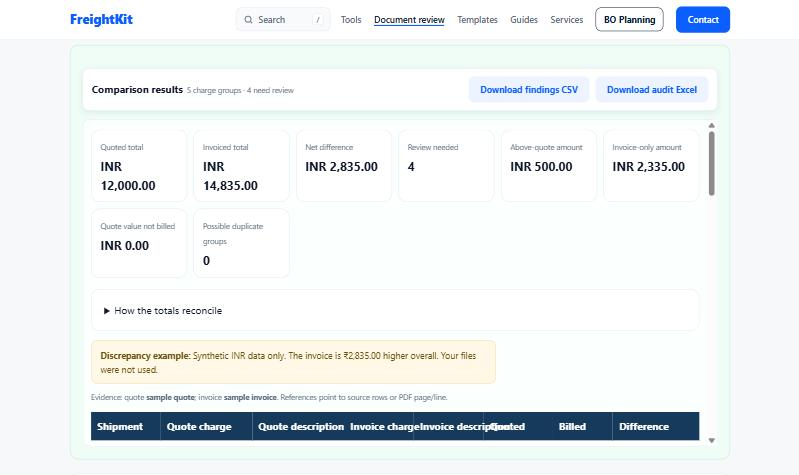
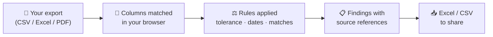
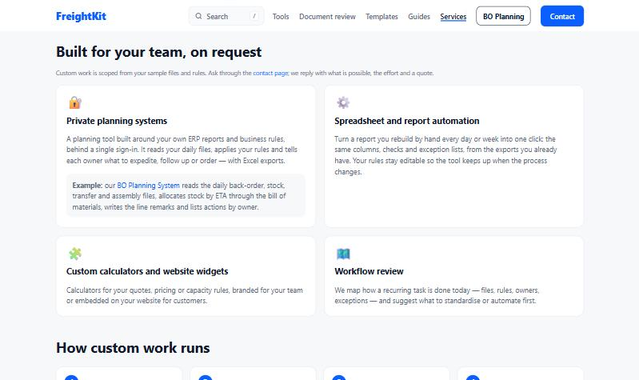
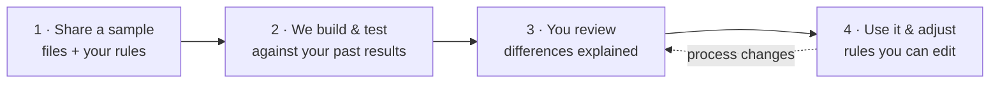
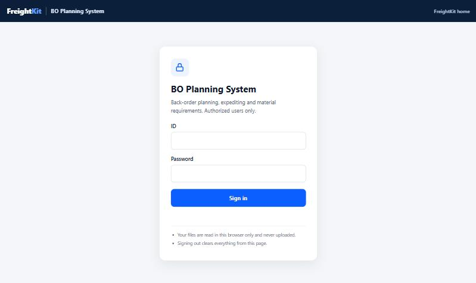
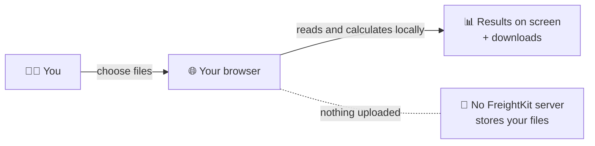

<div align="center">

<a href="https://freightkit.in/"></a>

# FreightKit

**Practical tools for freight, logistics, inventory and procurement work — free, in the browser, with the formula shown.**

[](https://freightkit.in/)
[](https://freightkit.in/tools/)
[](https://freightkit.in/templates/)
[](#privacy-by-design)
[](https://freightkit.in/)

[**Open FreightKit**](https://freightkit.in/) ·
[Calculators](https://freightkit.in/tools/) ·
[Invoice review](https://freightkit.in/document-process/) ·
[Templates](https://freightkit.in/templates/) ·
[Guides](https://freightkit.in/guides/) ·
[Services](https://freightkit.in/services/) ·
[**All pages and links**](links/)

</div>

---

## Contents

- [What you can do](#what-you-can-do)
- [A quick look](#a-quick-look)
- [Tool catalogue](#tool-catalogue)
- [Workflows](#workflows)
- [Templates and Excel workbooks](#templates-and-excel-workbooks)
- [Services](#services)
- [Privacy by design](#privacy-by-design)
- [For maintainers](#for-maintainers)
- [All pages and links →](links/) (every page and download with its live link; also as [links.csv](links/links.csv))

---

## What you can do

Pick the task, open the tool, enter your numbers or add your file, and get a result you can check, copy, share or download.

| I need to… | Use |
| --- | --- |
| 🧾 Check a carrier invoice against the agreed quote | [Freight invoice review](https://freightkit.in/document-process/) |
| ⚖️ Work out chargeable weight for air or courier | [Volumetric & chargeable weight](https://freightkit.in/tools/volumetric-weight/) · [Parcel DIM weight](https://freightkit.in/tools/parcel-dim-weight/) |
| 📦 Plan a container or pallet | [Container load planner](https://freightkit.in/tools/container-load/) · [Cartons per pallet](https://freightkit.in/tools/cartons-per-pallet/) · [CBM](https://freightkit.in/tools/cbm-calculator/) |
| 💰 Know the real cost of an import | [Landed cost](https://freightkit.in/tools/landed-cost/) · [Customs duty & import tax](https://freightkit.in/tools/customs-duty-estimator/) |
| 🤝 Compare suppliers or forwarders | [RFQ / quote comparison](https://freightkit.in/tools/rfq-comparison/) · [Supplier scorecard](https://freightkit.in/tools/supplier-scorecard/) |
| 📉 Set stock levels | [Safety stock & reorder point](https://freightkit.in/tools/safety-stock/) · [Min-max](https://freightkit.in/tools/min-max/) · [EOQ](https://freightkit.in/tools/eoq/) |
| ⏰ Chase late purchase orders | [PO & shipment exception report](https://freightkit.in/tools/po-exception-report/) |
| 📥 Start a tracker or checklist | [27 CSV templates and 5 Excel workbooks](https://freightkit.in/templates/) |
| 🛠️ Make a calculator for my own rule | [Custom calculator builder](https://freightkit.in/custom-calculator/) |

Press <kbd>/</kbd> or <kbd>Ctrl</kbd>+<kbd>K</kbd> on any page to search every tool, template and guide.

---

## A quick look

<table>
<tr>
<td width="50%"><br><sub><b>Home</b> — search everything, or start from a task.</sub></td>
<td width="50%"><br><sub><b>Task picker</b> — eight common jobs, one click each. Recently used tools appear below.</sub></td>
</tr>
<tr>
<td width="50%"><br><sub><b>Search</b> — tools, workflows, templates and guides in one list. Keyboard friendly.</sub></td>
<td width="50%"><br><sub><b>Invoice review</b> — quoted vs billed totals, above-quote and invoice-only charges, source rows.</sub></td>
</tr>
</table>

---

## Tool catalogue

Every calculator shows the formula, the assumptions and a step-by-step working. Results can be copied, shared as a link (inputs included), printed or downloaded as CSV.

<details open>
<summary><b>🚢 Freight & cargo</b> — 5 tools</summary>

[Volumetric & chargeable weight](https://freightkit.in/tools/volumetric-weight/) · [CBM calculator](https://freightkit.in/tools/cbm-calculator/) · [Container load planner](https://freightkit.in/tools/container-load/) · [Cartons per pallet](https://freightkit.in/tools/cartons-per-pallet/) · [Freight class density guide](https://freightkit.in/tools/freight-class/)
</details>

<details>
<summary><b>🚚 Freight & transport</b> — 9 tools</summary>

[Demurrage & detention](https://freightkit.in/tools/demurrage-detention/) · [Freight cost per kg / unit](https://freightkit.in/tools/freight-cost-per-kg/) · [Air vs sea](https://freightkit.in/tools/air-vs-sea/) · [LCL vs FCL](https://freightkit.in/tools/lcl-vs-fcl/) · [Cargo insurance](https://freightkit.in/tools/cargo-insurance/) · [Parcel DIM weight](https://freightkit.in/tools/parcel-dim-weight/) · [Shipment consolidation](https://freightkit.in/tools/shipment-consolidation/) · [Transport cost per delivery](https://freightkit.in/tools/transport-cost-per-delivery/) · [Shipment CO₂ estimator](https://freightkit.in/tools/shipment-co2/)
</details>

<details>
<summary><b>💰 Costs & conversion</b> — 3 tools</summary>

[Landed cost](https://freightkit.in/tools/landed-cost/) · [Logistics unit converter](https://freightkit.in/tools/unit-converter/) · [Customs duty & import tax](https://freightkit.in/tools/customs-duty-estimator/)
</details>

<details>
<summary><b>📊 Inventory & performance</b> — 9 tools</summary>

[EOQ](https://freightkit.in/tools/eoq/) · [Safety stock & reorder point](https://freightkit.in/tools/safety-stock/) · [Inventory turnover & days](https://freightkit.in/tools/inventory-turnover/) · [OTIF & fill rate](https://freightkit.in/tools/otif-fill-rate/) · [Days of supply](https://freightkit.in/tools/days-of-supply/) · [Min-max planner](https://freightkit.in/tools/min-max/) · [Inventory carrying cost](https://freightkit.in/tools/carrying-cost/) · [Simple demand forecast](https://freightkit.in/tools/demand-forecast/) · [ABC analysis](https://freightkit.in/tools/abc-analysis/)
</details>

<details>
<summary><b>🤝 Procurement</b> — 7 tools</summary>

[Supplier scorecard](https://freightkit.in/tools/supplier-scorecard/) · [RFQ / quote comparison](https://freightkit.in/tools/rfq-comparison/) · [Total cost of ownership](https://freightkit.in/tools/tco/) · [Make vs buy](https://freightkit.in/tools/make-vs-buy/) · [MOQ planner](https://freightkit.in/tools/moq-planner/) · [Early payment discount](https://freightkit.in/tools/early-payment-discount/) · [Cash conversion cycle](https://freightkit.in/tools/cash-conversion-cycle/)
</details>

<details>
<summary><b>🏭 Warehouse & 3PL</b> — 2 tools</summary>

[Warehouse cost per pallet](https://freightkit.in/tools/warehouse-cost-per-pallet/) · [Warehouse rack capacity](https://freightkit.in/tools/rack-capacity/)
</details>

<details>
<summary><b>🧰 Data & documents</b> — 5 tools</summary>

[Business-day lead time](https://freightkit.in/tools/business-day-lead-time/) · [GTIN / barcode check digit](https://freightkit.in/tools/gtin-check-digit/) · [Container number validator](https://freightkit.in/tools/container-validator/) · [CSV duplicate finder](https://freightkit.in/tools/csv-duplicate-finder/) · [Custom calculator builder](https://freightkit.in/custom-calculator/)
</details>

---

## Workflows

File-based reviews that turn an export into a list of things to check.

### 🧾 Freight invoice review

Compare an accepted quote or rate confirmation with the carrier invoice — CSV, Excel or text-based PDF.

- Finds **billed above quote**, **invoice-only charges**, **quoted but not billed** and possible duplicates.
- Suggests which columns to use, lets you match differently named charges (e.g. *Fuel surcharge = Fuel adjustment*) and set a tolerance.
- Every finding points back to its source row or PDF page, with what to check next.
- Try it with built-in sample data — no files needed.

[Open invoice review](https://freightkit.in/document-process/) · [Excel audit workbook](https://freightkit.in/downloads/freight-invoice-audit.xlsx)

### ⏰ PO & shipment exceptions

Upload a PO or shipment export; get overdue lines, missing ETAs, open quantities and owners, ready to send as a follow-up list. [Open the report](https://freightkit.in/tools/po-exception-report/)



---

## Templates and Excel workbooks

27 free CSV templates and 5 formula-led Excel workbooks that open in Excel, Google Sheets or LibreOffice.

| Area | Examples |
| --- | --- |
| Freight & shipping | Shipment tracker · Freight quote comparison · Container booking log · Demurrage & detention tracker |
| Audit & cost | Freight invoice audit · Landed cost & duty sheet · Transporter freight register |
| Procurement | PO tracker · Supplier scorecard · Supplier risk register · Vendor onboarding checklist |
| Inventory & warehouse | Inventory tracker · Reorder planner · Cycle count sheet · GRN receiving log · Pick-pack-dispatch |
| Trade & compliance | Import clearance checklist · Export documentation checklist · HS code tracker · GST e-way bill register · Letter of credit checklist |

**Excel workbooks:** [Freight invoice audit](https://freightkit.in/downloads/freight-invoice-audit.xlsx) · [Freight quote comparison](https://freightkit.in/downloads/freight-quote-comparison.xlsx) · [PO exception tracker](https://freightkit.in/downloads/po-exception-tracker.xlsx) · [Supplier scorecard](https://freightkit.in/downloads/supplier-scorecard-workbook.xlsx) · [Inventory reorder planner](https://freightkit.in/downloads/inventory-reorder-planner.xlsx)

[Browse all templates →](https://freightkit.in/templates/)

---

## Services



### Free, available now

| | |
| --- | --- |
| 🧮 **Calculators** | 40+ freight, inventory, procurement and warehouse calculators with visible formulas |
| 🧾 **Invoice review & PO exceptions** | File-based reviews that run in your browser |
| 📊 **Templates & workbooks** | 27 CSV templates and 5 Excel workbooks |
| 🛠️ **Calculator builder** | Your own inputs and formula, no code; save, share or embed |
| 📘 **Guides** | Incoterms 2020, bills of lading, shipping documents, customs delays, freight disputes, stock-outs |

### Built for your team, on request

| | |
| --- | --- |
| 🔐 **Private planning systems** | A planning tool built around your own ERP reports and rules, behind a single sign-in, telling each owner what to expedite, follow up or order |
| ⚙️ **Spreadsheet & report automation** | The report you rebuild by hand every day, in one click, from the exports you already have |
| 🧩 **Custom calculators & website widgets** | Calculators for your quotes, pricing or capacity rules, branded or embedded on your site |
| 🗺️ **Workflow review** | A map of how a recurring task is done today and what to standardise or automate first |



**Example — BO Planning System.** A private back-order planning tool built for one team. Each day it reads the ERP back-order report, stock file, transfer export and assembly schedule; allocates stock by ETA through the bill of materials; writes the line remarks; and lists what to expedite, follow up or order by owner, with lead times, forecasts and Excel exports. Rules (routes, vendors, lead times, wording) are edited on a settings page. It sits behind one ID and password, and its code ships encrypted.



[See services →](https://freightkit.in/services/) · [Contact →](https://freightkit.in/contact/)

---

## Privacy by design



- Calculators and file reviews run **entirely in the browser**. Files are not uploaded to FreightKit or stored on a server.
- No account is needed. Saved calculations and "recently used" stay in your own browser and can be cleared.
- Results are decision support: confirm rates, contracts, customs and tax rules with the relevant source before acting.

FreightKit does not provide live carrier rates, ERP connections, cloud workspaces or automatic supplier messaging.

---

## For maintainers

<details>
<summary><b>Repository layout</b></summary>

```text
FreightKit/
├── index.html                 Home (task picker, search, recently used)
├── tools/                     40+ calculators and file tools (one folder each)
├── document-process/          Freight invoice review workflow
├── templates/  downloads/     Template directory and the CSV / XLSX files
├── guides/                    Operational guides
├── services/                  Services (free and on request)
├── bo-planning/               Private BO Planning System (sign-in + encrypted bundle)
├── custom-calculator/  embed/ Calculator builder and embeddable runtime
├── solutions/ pro/ pricing/ about/ contact/ suggest/ privacy/ terms/
├── assets/
│   ├── css/style.css          Shared styles
│   ├── js/app.js              Calculators and result actions (copy, share, CSV, print)
│   ├── js/site-search.js      Site search (/ or Ctrl+K) and recently used tools
│   ├── js/search-index.js     Search index (generated)
│   ├── js/document-process-v4.js, workflows.js   File workflows
│   └── vendor/                SheetJS, PDF.js
├── scripts/                   Site checks, search index, BO bundle builder, domain helper
├── docs/                      Hosting / release notes and README screenshots
├── links/                     All pages and links (README.md + links.csv, made by scripts/build-links-page.py)
├── sitemap.xml  robots.txt  .htaccess  site.webmanifest
└── contact-handler.php        Form handler for PHP hosting (config kept out of git)
```
</details>

<details>
<summary><b>Run locally</b></summary>

```bash
python -m http.server 8000
```

Open <http://localhost:8000/>. The site is static; the PHP contact handler needs PHP hosting.
</details>

<details>
<summary><b>Before publishing</b></summary>

```bash
python scripts/build-search-index.py   # after adding or renaming a page or template
python scripts/build-links-page.py     # refresh links/ (all pages and links) after adding or renaming a page
python scripts/check-site.py           # links, assets, SEO tags
```

- Keep internal links relative so the site works at a domain root and under `/FreightKit/` on GitHub Pages.
- Add new indexable pages to `sitemap.xml`.
- Never commit passwords, API keys, `contact-config.php`, customer files, `bo-src/` or `sample/`.
</details>

<details>
<summary><b>Hosting</b></summary>

- **freightkit.in** — Hostinger (upload changed files to `public_html`).
- **GitHub Pages** — [ionianverse.github.io/FreightKit](https://ionianverse.github.io/FreightKit/), published from `main`.

GitHub Pages does not run PHP; forms need PHP hosting or a form service. See [START-HERE.md](START-HERE.md), [docs/](docs/) and [AUDIT_AND_ROADMAP.md](AUDIT_AND_ROADMAP.md).
</details>

---

<div align="center">

**Feedback, tool ideas or a task to automate?** [Contact FreightKit](https://freightkit.in/contact/) · [Suggest a tool](https://freightkit.in/suggest/)

<sub>Results are estimates and decision support. Verify carrier, customs and tax rules before acting.</sub>

</div>
