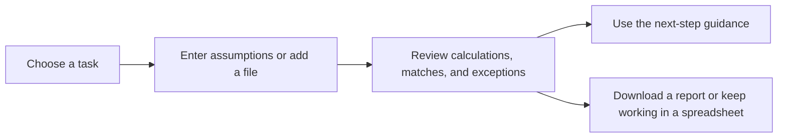

# FreightKit — practical tools for logistics and supply-chain work

FreightKit helps logistics, procurement, warehouse, and finance teams turn everyday operational questions into clear, usable answers. Use simple calculators, document reviews, templates, and guides to spot cost differences, check shipment data, plan inventory, and make better-informed decisions.

<p align="center">
  <a href="https://freightkit.in/">
    
  </a>
</p>

<p align="center">
  <a href="https://freightkit.in/">Visit FreightKit</a> ·
  <a href="https://freightkit.in/tools/">Explore tools</a> ·
  <a href="https://freightkit.in/document-process/">Review documents</a> ·
  <a href="https://freightkit.in/templates/">Get templates</a>
</p>

## Solve common day-to-day problems

| What teams need to do | FreightKit helps with |
| --- | --- |
| Check whether a freight invoice matches an accepted quote | Compare quote and invoice line items, highlight differences, show source row references, and export findings. |
| Compare transport or forwarder offers | Review charges, transit time, validity, and all-in freight costs side by side. |
| Understand shipment size and freightable weight | Calculate CBM, volumetric weight, chargeable weight, container load, and freight cost per unit. |
| Track orders, shipments, and exceptions | Use PO and shipment workflows to identify late, missing, or changed operational details. |
| Plan stock and replenishment | Estimate safety stock, reorder points, days of supply, EOQ, and inventory carrying cost. |
| Estimate import and delivery costs | Build landed-cost estimates and review customs, duty, and transport inputs. |
| Improve warehouse and supplier visibility | Review capacity, pallet costs, supplier performance, and operational KPIs. |
| Standardize repeat work | Download ready-to-use CSV and Excel templates for tracking, audits, checklists, and planning. |

Start with the [Tools directory](https://freightkit.in/tools/) or the [Document Process workspace](https://freightkit.in/document-process/). The website also includes practical [guides](https://freightkit.in/guides/) and [solution pages](https://freightkit.in/solutions/).

## Featured workflows

### Freight invoice review

Compare an accepted quote or rate confirmation with a carrier invoice. The workflow helps surface billed-above-quote lines, invoice-only charges, quote lines that were not billed, and amounts within tolerance. It supports CSV, XLSX, and text-based PDF input, suggests likely columns, and provides source references and review steps.

[Open Freight Invoice Review](https://freightkit.in/document-process/) · [Download the audit workbook](https://freightkit.in/downloads/freight-invoice-audit.xlsx) · [Download the starter CSV](https://freightkit.in/downloads/freight-audit.csv)

### Freight, warehouse, and supply-chain calculators

Browse calculators for quote comparison, landed cost, container and cargo planning, inventory, supplier performance, warehouse capacity, cash flow, and more.

[Browse all tools](https://freightkit.in/tools/)

### Ready-to-use templates

Download CSV and Excel workbooks for shipment tracking, freight audits, quote comparisons, demurrage and detention, receiving, inventory, supplier reviews, import/export checklists, and other recurring tasks.

[Browse templates](https://freightkit.in/templates/)

## How FreightKit works



Most calculators run in the browser. The Document Process file review runs locally in the browser as well; files are not uploaded to FreightKit. It currently compares structured line-item data and text-based PDFs. Scanned PDFs and images need OCR and are not supported by that workflow yet.

Results are decision support. Confirm rates, contracts, shipment events, customs requirements, and tax treatment against the relevant source documents before taking action. FreightKit does not provide live carrier tracking, ERP connections, or automatic supplier/carrier communication.

## What this repository contains

```text
FreightKit/
├── index.html                    # Homepage
├── assets/
│   ├── css/                      # Shared site styles
│   ├── js/                       # Calculators and browser-based workflows
│   ├── img/                      # Site icons and share image
│   └── vendor/                   # Browser libraries (PDF.js, SheetJS)
├── tools/                        # Individual calculators and data tools
├── document-process/             # Document workflow landing page
├── solutions/                    # Logistics and supply-chain solution pages
├── templates/                    # Downloadable template directory
├── downloads/                    # CSV templates and Excel workbooks
├── guides/                       # Operational explainers and how-to guides
├── custom-calculator/            # Calculator request/build pages
├── pro/                          # Pro service information
├── pricing/                      # Pricing information
├── contact/                      # Contact page
├── suggest/                      # Tool and content suggestions
├── contact-handler.php           # PHP form handler for PHP-enabled hosting
├── contact-config.example.php    # Safe configuration example
├── docs/                         # Hosting, release, domain, and maintenance docs
├── scripts/                      # Site checks and domain helper scripts
├── .htaccess                     # Apache hosting rules
├── sitemap.xml                   # Search-engine sitemap
└── robots.txt                    # Crawler rules
```

### Main browser code

- `assets/js/app.js` — shared calculator and site behavior.
- `assets/js/workflows.js` — document workflow interface and file handling.
- `assets/js/document-process-v4.js` — current freight invoice review and discrepancy logic.
- `assets/vendor/sheetjs/` — XLSX parsing in the browser.
- `assets/vendor/pdfjs/` — text-based PDF parsing in the browser.

## Run the website locally

The site is static-first. Run a local web server from the repository root:

```bash
python -m http.server 8000
```

Then open <http://localhost:8000/>. This previews the HTML, calculators, templates, and browser workflows. The PHP contact handler needs PHP-enabled hosting and server-side mail configuration; Python's static server does not process PHP forms.

## Deployment and hosting

The repository is published through GitHub Pages from the `main` branch and repository root. The live website is [freightkit.in](https://freightkit.in/); the GitHub Pages project URL is [ionianverse.github.io/FreightKit](https://ionianverse.github.io/FreightKit/).

GitHub Pages serves static files and does not execute PHP. If using Pages for hosting, contact and suggestion form submissions need a separate PHP host or a configured form service. Do not put private server configuration in the repository.

## Contributing and maintaining

1. Make a focused change in the relevant page, calculator, workflow, or shared asset.
2. Keep calculator assumptions, units, formulas, and limitations visible to users.
3. Keep internal links relative so pages work from both the custom domain and the GitHub Pages project path.
4. Update the sitemap when adding an indexable page.
5. Never commit passwords, API keys, hosting credentials, customer documents, or `contact-config.php`.

For setup and release details, see [START-HERE.md](START-HERE.md), [docs/](docs/), and [AUDIT_AND_ROADMAP.md](AUDIT_AND_ROADMAP.md).

## Contact

For feedback, tool requests, or calculator ideas, use the [FreightKit contact page](https://freightkit.in/contact/) or the repository's GitHub issues.
