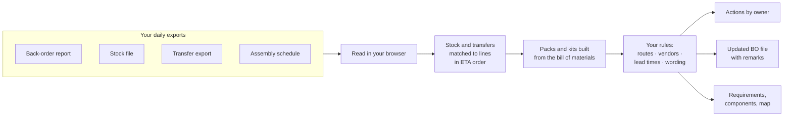
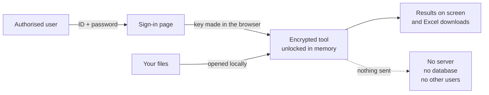
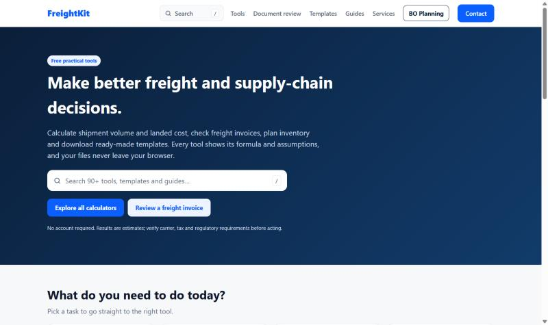
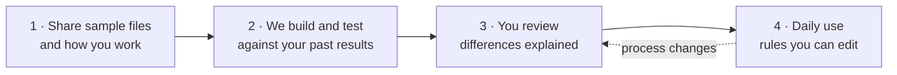

<div align="center">

<a href="https://freightkit.in/"></a>

# FreightKit

**Back-order planning and logistics tools that run in your browser — your files never leave your computer.**

[](https://freightkit.in/)
[](#bo-planning-system)
[](#data-security-and-privacy)
[](https://freightkit.in/tools/)

[**BO Planning System**](#bo-planning-system) ·
[Data security](#data-security-and-privacy) ·
[Free tools](#free-tools) ·
[Services](#services) ·
[**All pages and links**](links/)

</div>

---

## Contents

1. [BO Planning System — our main product](#bo-planning-system)
2. [What it does each day](#what-it-does-each-day)
3. [Inside the tool](#inside-the-tool)
4. [Tested on real data](#tested-on-real-data)
5. [Data security and privacy](#data-security-and-privacy)
6. [Free tools](#free-tools)
7. [Services](#services)
8. [All pages and links](#all-pages-and-links)
9. [For maintainers](#for-maintainers)

---

<a id="bo-planning-system"></a>
## 1. BO Planning System

**A daily back-order planning tool for manufacturers and distributors.** It reads the reports your team already exports — back-order report, stock file, transfer export, assembly schedule — and in a few seconds tells each owner what to **expedite**, **follow up** or **order**, writes the line remarks, and shows the whole picture on one screen.

| Before | With BO Planning |
| --- | --- |
| Hours each morning checking stock, transfers and schedules line by line | The full plan in seconds, from the same files |
| Remarks written by hand, often out of date | Remarks suggested from today's data; true ones kept as written |
| Shortages found late | Every shortage → "place order", in ETA order, never hidden |
| Hard to see the whole network | Dashboard, filters and an interactive warehouse map |
| Knowledge in people's heads | Rules (routes, vendors, lead times, wording) on a settings page anyone can edit |

<p align="center"><br><sub>Overview — what to do today, by owner. <i>Illustration with sample data.</i></sub></p>

**Access:** private, one sign-in per organisation. [Ask for a demo or a system for your own reports →](https://freightkit.in/contact/)

---

<a id="what-it-does-each-day"></a>
## 2. What it does each day



1. **Add the files you have.** None is required — each screen shows what it can and says which file it still needs.
2. **Stock goes to the earliest ETA first.** Each line walks its route: transfer to its warehouse, stock and work in progress, process stages, outside vendors, open purchase orders — and anything still missing becomes **place order**.
3. **Kits and packs** are checked part by part from the bill of materials; a finished kit already in stock is used first.
4. **Remarks are checked, not overwritten.** Remarks that are still true are kept; the rest get a suggestion you can edit. Lines marked "disregard" are left out.
5. **Need-by dates** come from the ETA minus each stage's lead time, so you know what is late today.

---

<a id="inside-the-tool"></a>
## 3. Inside the tool

| Screen | What you get |
| --- | --- |
| **Overview** | Expedite / place order / follow up counts and a card per owner (production, foundries, outside vendors, suppliers) with one-click Excel |
| **Actions** | Every action with need-by date, owner and evidence; filter by status, owner, warehouse, customer (type or paste a list), ETA |
| **Requirements & Materials** | What is needed per item, beside stock, open POs and forecast |
| **Planned lines** | Lines planned without allocation, analysed after real lines so they never take their stock |
| **Components** | Stock at each process stage (ground, machined, thread-rolled, painted…), coverage in months, and a process plan to reach 3 months of stock |
| **Transfers** | Open transfers, age and which BO lines they serve |
| **Analysis** | Charts by status, owner, region, warehouse, week and customer, plus the **distribution network map** |
| **Remarks** | Each remark checked against today's data; download the **updated BO file** with the new remarks written in |
| **Rules** | Routes, vendors, lead times, wording, warehouses — edit, save, export and import |

<p align="center"><br><sub>Analysis → distribution network. Each warehouse shows its number, its plan-status mix and open transfers. Click a warehouse or a state to filter; <b>Reset map</b> and <b>Download selection</b> are one click. <i>Illustration with sample warehouses and data.</i></sub></p>

**Every download offers two choices:** *results only*, or *results + your original data* (every column of the BO line, transfer or stock row).

---

<a id="tested-on-real-data"></a>
## 4. Tested on real data

The system was built and checked against a real team's daily files (about 750 back-order lines a day, four daily files).

| Check | Result |
| --- | --- |
| Agreement with the planners' own remarks | **about 4 in 5 lines** (76–82%), rising as rules were refined |
| Where it differs | Mostly remarks behind today's stock (e.g. stock already arrived) or notes only the team knows |
| Stock used more than once, or more than the file has | **0** |
| A later-ETA line served before an earlier one | **0** |
| Transfers used beyond the open quantity | **0** |
| Line splits that do not add up to the BO quantity | **0** |

These checks are re-run whenever the rules change.

---

<a id="data-security-and-privacy"></a>
## 5. Data security and privacy



| | |
| --- | --- |
| **Files stay on your computer** | Every file is opened and calculated inside the browser tab. Nothing is uploaded, stored or sent anywhere, and no other user can see it. |
| **Locked page** | The page's security policy blocks it from sending data to any other website. |
| **Encrypted product** | The BO Planning code ships encrypted (AES-256-GCM, key from the ID and password with PBKDF2-SHA256, 600,000 rounds). Without the sign-in it cannot be read or run. |
| **One sign-in** | A single ID and password per organisation; changing it re-encrypts the tool and the old one stops working. |
| **Nothing kept** | Refreshing or signing out clears the files from the page. Saved rules stay only in that browser until you choose "Forget everything on this device". |
| **No company data in this repository** | The readable source, rules and sample files are kept private; only the encrypted file is published. |

The free tools work the same way: calculations and file reviews run in the browser, with no account needed.

---

<a id="free-tools"></a>
## 6. Free tools

Open to everyone at **[freightkit.in](https://freightkit.in/)** — no sign-up. Every calculator shows its formula and working.

| Area | Examples |
| --- | --- |
| 🧾 File reviews | [Freight invoice review](https://freightkit.in/document-process/) (quote vs invoice, CSV / Excel / PDF) · [PO & shipment exceptions](https://freightkit.in/tools/po-exception-report/) |
| 🚢 Freight & cargo | [Chargeable weight](https://freightkit.in/tools/volumetric-weight/) · [CBM](https://freightkit.in/tools/cbm-calculator/) · [Container load](https://freightkit.in/tools/container-load/) · [Landed cost](https://freightkit.in/tools/landed-cost/) |
| 📊 Inventory | [Safety stock & reorder point](https://freightkit.in/tools/safety-stock/) · [EOQ](https://freightkit.in/tools/eoq/) · [Min-max](https://freightkit.in/tools/min-max/) · [ABC analysis](https://freightkit.in/tools/abc-analysis/) |
| 🤝 Procurement | [Supplier scorecard](https://freightkit.in/tools/supplier-scorecard/) · [RFQ comparison](https://freightkit.in/tools/rfq-comparison/) · [Total cost of ownership](https://freightkit.in/tools/tco/) |
| 🛠️ Build your own | [Custom calculator builder](https://freightkit.in/custom-calculator/) — your inputs and formula, no code |
| 📥 Templates | [27 CSV templates and 5 Excel workbooks](https://freightkit.in/templates/) · [Guides](https://freightkit.in/guides/) |

<table>
<tr>
<td width="50%"><br><sub><b>Home</b> — search everything or start from a task.</sub></td>
<td width="50%"><br><sub><b>Invoice review</b> — billed vs quoted, with the source row for each finding.</sub></td>
</tr>
</table>

[See all 40+ tools →](https://freightkit.in/tools/)

---

<a id="services"></a>
## 7. Services

We build private planning tools around **your own** exports and rules — like the BO Planning System.



| Service | What you get |
| --- | --- |
| 🔐 **Private planning systems** | Daily plans from your ERP reports, behind one sign-in, telling each owner what to do |
| ⚙️ **Report automation** | The report your team rebuilds by hand every day, in one click |
| 🧩 **Custom calculators** | Quote, pricing or capacity rules as a branded calculator or website widget |

[Services →](https://freightkit.in/services/) · [Contact →](https://freightkit.in/contact/)

---

<a id="all-pages-and-links"></a>
## 8. All pages and links

Every page and download, with its live link, is listed in the **[links folder](links/)** — also as a spreadsheet: [links.csv](links/links.csv).

| Key links | |
| --- | --- |
| Live site | [freightkit.in](https://freightkit.in/) · copy on [GitHub Pages](https://ionianverse.github.io/FreightKit/) |
| BO Planning System (sign-in) | [freightkit.in/bo-planning](https://freightkit.in/bo-planning/) |
| Free tools · Templates · Guides | [Tools](https://freightkit.in/tools/) · [Templates](https://freightkit.in/templates/) · [Guides](https://freightkit.in/guides/) |
| Services · Contact | [Services](https://freightkit.in/services/) · [Contact](https://freightkit.in/contact/) |
| Privacy · Terms | [Privacy](https://freightkit.in/privacy/) · [Terms](https://freightkit.in/terms/) |

---

<a id="for-maintainers"></a>
## 9. For maintainers

<details>
<summary><b>Repository layout</b></summary>

```text
FreightKit/
├── index.html           Home
├── bo-planning/         BO Planning System: sign-in page + encrypted bundle (app.bundle)
├── tools/               40+ calculators and file tools
├── document-process/    Freight invoice review
├── templates/ downloads/ guides/ services/ …   Other pages and files
├── assets/              Styles, scripts, images, vendor libraries (SheetJS, PDF.js)
├── links/               All pages and links (made by scripts/build-links-page.py)
├── docs/                Hosting notes and README images
└── scripts/             Site checks, search index, links page, BO bundle builder
```
</details>

<details>
<summary><b>Run and check</b></summary>

```bash
python -m http.server 8000                # then open http://localhost:8000/
python scripts/build-search-index.py      # after adding or renaming a page
python scripts/build-links-page.py        # refresh links/
python scripts/check-site.py              # links, assets and SEO tags
```

- The BO Planning source, rules and sample files are private and never committed; only `bo-planning/app.bundle` is published.
- Never commit passwords, keys, `contact-config.php` or customer files.
- Hosting: **freightkit.in** on Hostinger (upload to `public_html`) and **GitHub Pages** from `main`.
</details>

---

<div align="center">

**Want a planning system built around your own reports?** [Contact FreightKit](https://freightkit.in/contact/)

<sub>Results are decision support. Confirm supplier, carrier, customs and tax details before acting.</sub>

</div>
