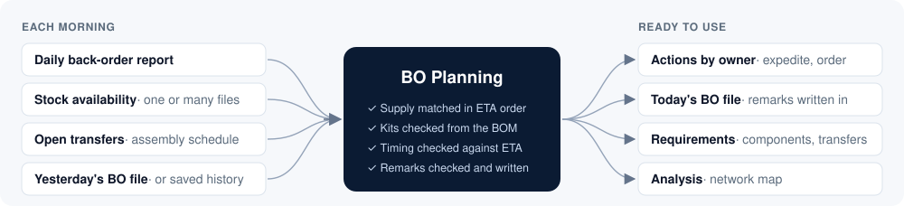

<p align="center"><a href="https://freightkit.in/bo-planning/"></a></p>

<h1 align="center">FreightKit</h1>

<p align="center"><b>Daily back-order planning for manufacturers and distributors.</b><br>
Every morning, from the reports your ERP already exports: what to expedite, follow up or order — line by line.</p>

<p align="center"><a href="#bo-planning-system">Product</a> &nbsp;·&nbsp; <a href="#how-it-works">How it works</a> &nbsp;·&nbsp; <a href="#daily-bo-file">Daily BO file</a> &nbsp;·&nbsp; <a href="#security">Security</a> &nbsp;·&nbsp; <a href="#products-and-links">Products and links</a> &nbsp;·&nbsp; <a href="https://freightkit.in/contact/">Contact</a></p>

---

<a id="bo-planning-system"></a>
## BO Planning System

A private planning system for teams that manage open back orders every day. It reads the daily exports from your ERP, matches stock, transfers and production to every order line in ETA order, and tells each owner — production, foundries, outside processors, suppliers, receiving — what to do today. It writes the line remarks and gives back the day's BO file, ready to share.

| Without it | With BO Planning |
| --- | --- |
| Hours each morning rebuilding the BO file and checking every line | The BO file and the full plan in seconds, from the same exports |
| Remarks typed by hand and often out of date | Remarks checked against today's data; true ones kept, the rest suggested |
| Shortages and late lines found too late | Every shortage becomes "place order"; late lines flagged against the customer ETA |
| Hard to see the whole network | Dashboard, filters and an interactive warehouse map |
| Know-how in a few people's heads | Routes, suppliers, lead times and wording kept as rules the team can edit |

<p align="center"><br><sub>Overview — what to do today, by owner. Illustration with sample data.</sub></p>

---

<a id="how-it-works"></a>
## How it works

<p align="center"></p>

1. **Add today's exports** — any combination; each screen says which file it still needs.
2. **Yesterday carries over** — remarks, actions, special instructions, hot orders and manual item details.
3. **Supply goes to the earliest ETA first** — stock, transfers, production, outside processes and open orders; anything still missing becomes *place order*.
4. **Timing is checked against the customer ETA**, including production and transfer time, so late lines show up today.

---

<a id="daily-bo-file"></a>
## The daily BO file

<p align="center"><br><sub>Rebuilt every morning from the ERP daily back-order report. Illustration with sample data.</sub></p>

- New lines added and closed lines removed — both listed separately with their remarks.
- Sorted by customer ETA, promise date, order status, allocation, order date and order line.
- Hot orders, today's new lines, kit material lines and planned lines highlighted.
- Item master and bill of materials built in, with add, change and delete.
- Downloaded in your own layout, or only the lines that changed.

---

## Network view

<p align="center"><br><sub>Analysis → distribution network: every warehouse with its plan status and the open transfers from the Houston hub. Click a warehouse or a state in the tool to filter everything. Example day from testing.</sub></p>

| Screen | What you get |
| --- | --- |
| Today | One work list: every line with its status, what to do, who, requests and the new remark; any BO column shown or hidden, filters under each heading, saved views, Done ticks and a five-step daily checklist |
| Requests & emails | The team's daily requests ready to send: WH change, Starbond substitute, alternative item, split line, ETA and lead-time requests; click the boxes to see one or several kinds; each one tracked to the next day |
| Overview | Counts to expedite, order and follow up; **Changes** (BOM, item details, process steps, lead times, vendors, foundries) saved and used by every calculation; missing item details to fill in; a card per owner; reserve stock that can save late lines |
| Actions | Every action with need-by date, owner and the stock behind it, with filters |
| Requirements and materials | What each item still needs, beside stock, open orders and forecast |
| Components | Stock of every process stage in order after the forecast, what to expedite, build or buy, and a weekly plan (forecast ÷ 4) |
| Transfers | A map of every open lane between warehouses, late and old transfers, and the order lines they serve |
| Analysis | Charts by status, owner, region, warehouse, week and customer, plus the network map |
| Planned lines | Every planned-without-allocation row laid out like the BO file, any column shown or hidden, what each one needs |
| Remarks | Each remark checked against today; edit, mark hot orders, download the BO file in the team's own layout; Row, risk dot, stage columns (asm / SB line, machining, grinding, casting) |
| Rules | Routes, suppliers, lead times, warehouses, wording, item master and BOM |

---

<a id="security"></a>
## Security and privacy

| Protection | How it works |
| --- | --- |
| Approved users only | Anyone can request an account; the admin approves or declines each request. Passwords are stored as one-way hashes, with lockout after repeated wrong attempts. |
| Files stay with you | Files are opened and planned in the browser. Nothing goes to the server until the user presses Save work. |
| Encrypted saved work | A save (that day's files, rules and edits) is encrypted on the server (AES-256-GCM) and readable only by that user's account. |
| Encrypted product | The system ships encrypted with a new key on every build; the server hands the key only to signed-in, approved users. |
| Automatic sign-out | After one hour without activity (or 12 hours) the session ends and everything loaded is cleared. |
| Private source | Source code, rules and customer files are never published. This repository is private. |

---

## Proven on real data

Built and checked against a real team's daily files — about 750 to 800 back-order lines a day.

| Check | Result |
| --- | --- |
| Agreement with the planners' own remarks | About 4 in 5 lines (up to 82 %) |
| BO file rebuilt from the ERP daily report | Same plan as the team's own file on all 788 lines |
| New lines, hot orders and planned lines | Match the team's own highlights |
| Stock used twice, or more than the file holds | 0 |
| A later-ETA line served before an earlier one | 0 |

---

<a id="products-and-links"></a>
## Products and links

| Product | What it does | Link |
| --- | --- | --- |
| **BO Planning System** | Daily back-order planning from your ERP reports (sign-in required) | [freightkit.in/bo-planning](https://freightkit.in/bo-planning/) |
| **Freight invoice review** | Freight quotes compared with invoices, each difference with its source row | [freightkit.in/document-process](https://freightkit.in/document-process/) |
| **Custom calculator builder** | Your own calculator from your inputs and formula, no code | [freightkit.in/custom-calculator](https://freightkit.in/custom-calculator/) |
| **Custom planning systems** | Private tools like this one, built around your exports and rules | [freightkit.in/services](https://freightkit.in/services/) |
| **Free calculators** | Freight, inventory, procurement and warehouse calculators | [freightkit.in/tools](https://freightkit.in/tools/) |

Every page of the website, with its link: **[links folder](links/)** (also as [links.csv](links/links.csv)).

---

<details>
<summary>For maintainers</summary>

```text
bo-planning/   BO Planning System: sign-in page and encrypted app.bundle
tools/         Calculators and file tools
assets/        Styles, scripts, images, vendor libraries
links/         Products and links (scripts/build-links-page.py)
docs/          Hosting notes and README images
scripts/       Site checks, links page, BO bundle and master builders
```

```bash
python scripts/check-site.py          # links, assets and SEO tags
python scripts/build-links-page.py    # refresh links/
python scripts/build-bo-bundle.py     # rebuild the encrypted BO Planning bundle
```

The BO Planning source, rules, master data and customer files are never committed; only `bo-planning/app.bundle` is. Website: freightkit.in (Hostinger, `public_html`).

</details>

---

<a id="rights"></a>
<p align="center"><b>Want a planning system built around your own reports?</b> <a href="https://freightkit.in/contact/">Contact FreightKit</a></p>

<p align="center"><sub>© 2026 FreightKit. All rights reserved. Proprietary software in a private repository: no licence is granted to use, copy, modify or distribute any part of this code, design or content.</sub></p>
